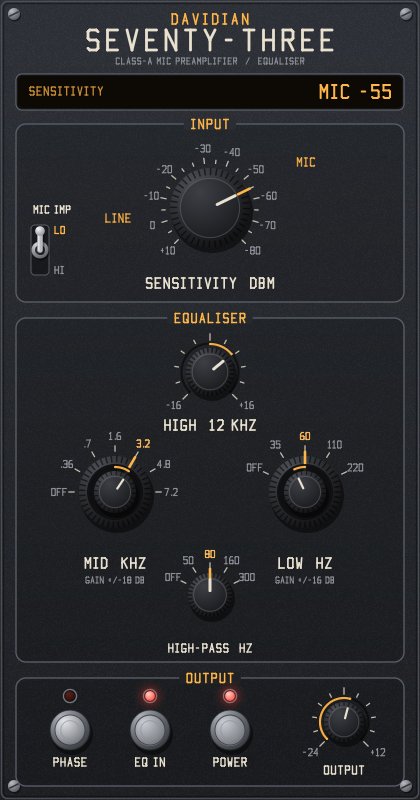

# Davidian Seventy-Three

A circuit-modelled channel strip plugin (LV2, VST3 and Audio Unit), built from a reference schematic: a class-A microphone preamplifier and equaliser with mic and line input transformers, a stepped sensitivity switch, an 18 dB/octave high-pass filter, a resonant low shelf, a mid bell, a 12 kHz high shelf, and a class-A output stage driving an output transformer.

**A close model, not an exact copy.** It is a simulation of the circuit from its component values, not a sampled or measured unit, and some details are reasoned estimates (listed under [Estimates](#estimates)). It has not been compared side by side with a built unit, so expect it to sound close to the hardware rather than identical.



Mono or stereo: on a stereo track each side runs through its own channel model with the same settings. The GUI is the same in every format. GPL-3.0-or-later.

| Format | Windows | macOS | Linux |
|---|---|---|---|
| LV2 | yes | yes | yes |
| VST3 | yes | | |
| Audio Unit (AUv2) | | yes | |

## Download

Ready-made builds are on the [Releases page](https://github.com/evadavevadave/davidian-seventy-three/releases):

| Download | Contains | For |
|---|---|---|
| `…-windows-x64.zip` | LV2, VST3 | Windows 10/11, 64-bit hosts |
| `…-macos-universal.zip` | LV2, Audio Unit | macOS 10.13 or later, Apple silicon and Intel |
| `…-linux-x64.zip` | LV2 | 64-bit Intel/AMD Linux (glibc 2.35 or later) |
| `…-linux-arm64.zip` | LV2 | 64-bit ARM Linux, e.g. Raspberry Pi 4/5 (glibc 2.35 or later) |

Unzip, copy the plugin folder for your host's format into its plugin folder, and restart your host (or rescan plugins):

| Format | Copy | Into |
|---|---|---|
| VST3 (Windows) | `seventy_three.vst3` | `C:\Program Files\Common Files\VST3` |
| Audio Unit (macOS) | `seventy_three.component` | `~/Library/Audio/Plug-Ins/Components` |
| LV2 (Windows) | `seventy_three.lv2` | `%APPDATA%\LV2` (create it if it doesn't exist) |
| LV2 (macOS) | `seventy_three.lv2` | `~/Library/Audio/Plug-Ins/LV2` |
| LV2 (Linux) | `seventy_three.lv2` | `~/.lv2` |

In the host it is listed as **Davidian Seventy-Three** (VST3, LV2) or under **Davidian** as **Seventy-Three** (Audio Unit). The LV2 version is mono; hosts such as Ardour run one copy per side on a stereo track.

The macOS build isn't notarized, so macOS may block it after download. Run these once in Terminal after copying:

```bash
xattr -dr com.apple.quarantine ~/Library/Audio/Plug-Ins/Components/seventy_three.component
```

```bash
xattr -dr com.apple.quarantine ~/Library/Audio/Plug-Ins/LV2/seventy_three.lv2
```

Logic Pro and GarageBand only show an Audio Unit once macOS has registered it. If it doesn't appear, log out and back in, or restart the Mac.

## Controls

The panel runs top to bottom like a console channel strip.

| Section | Control | What it does |
|---|---|---|
| Input | Sensitivity | The stepped gain switch: LINE +10 to -20 (gain -10 to +20 dB) and MIC -20 to -80 (+20 to +80 dB of amplifier gain), in 5 dB steps. The marking is the input level that gives 0 dBu out. |
| Input | Mic Imp LO / HI | The mic transformer's primaries in parallel (LO, 300 ohms) or series (HI, 1200 ohms). HI is 3.5 dB quieter and slightly more open at the top. |
| Equaliser | High 12 kHz | First-order shelf, ±16 dB |
| Equaliser | Mid: skirt and inner knob | Frequency OFF, 360 Hz, 700 Hz, 1.6, 3.2, 4.8, 7.2 kHz on the outer skirt; gain ±18 dB on the inner knob |
| Equaliser | Low: skirt and inner knob | Frequency OFF, 35, 60, 110, 220 Hz on the skirt; gain ±16 dB on the inner knob. A resonant second-order shelf: boosting also dips a little above the shelf. |
| Equaliser | High-Pass | OFF, 50, 80, 160, 300 Hz, 18 dB/octave |
| Output | Phase | Polarity invert |
| Output | EQ In | Takes the shelves and the mid out (the high-pass stays) |
| Output | Power | Plugin bypass, delayed to match the latency. In VST3 it is the host's bypass switch, and in an Audio Unit the host's bypass turns it off. |
| Output | Output | Output level, -24 to +12 dB, between the equaliser and the output stage, as the original's output fader. Turning it up drives the output stage and transformer harder. |

Drag knobs up or down, hold Shift to fine-tune, use the mouse wheel, and double-click to reset. On the concentric pairs, grab the inner knob for gain and the outer skirt for frequency. Switching a band, the EQ or the filter in or out crossfades, so it doesn't click.

### Levels

0 dBFS is +18 dBu (a full-scale sine is 6.16 V rms). The LINE positions take the input as a line-level signal. On the MIC positions the input is treated as a microphone signal 40 dB below line level, so MIC -40 is unity gain from input to output, MIC -60 is +20 dB and MIC -80 is +40 dB. To hear the amplifiers and transformers work, turn the sensitivity up and the output down.

## How it is modelled

All of it is in `src/circuit.h`.

- **Input transformers:** the mic and line transformers are modelled by their core flux: the source resistance drives the magnetising inductance, which falls as the core nears saturation, so low frequencies at high level lose level and gain odd harmonics. Each has a second-order high-frequency network for its winding capacitance and load (C1 180p on the mic transformer, C6 2n2 on the line transformer).
- **Amplifiers:** the first amplifier's gain is set by the sensitivity switch; its loop gain falls as its gain rises, so it has more second harmonic and less bandwidth at the high mic settings. The second amplifier adds a fixed 10 dB. Each stage is a feedback amplifier with asymmetric clipping and coupling capacitors.
- **Filter and equaliser:** the high-pass is a third-order Butterworth, as three filter sections on the filter card. The low shelf, mid bell and high shelf are analog prototypes, converted with the bilinear transform at the oversampled rate. A dedicated amplifier sets the equaliser's headroom.
- **Output:** the output level, then a single-ended class-A output stage (the most second harmonic) and the output transformer with its Zobel network (R64 1k5, C9 10n), saturating at low frequencies above about +22 dBu.
- **Oversampling** (`src/oversample.h`): 4x at 44.1/48 kHz, 2x at 88.2/96 kHz, none above. The latency is 64 samples (1.3 ms at 48 kHz; 0 when not oversampling), and the plugin reports it to the host.

### Checked against the published specifications

`test_dsp` checks the model against the published performance figures for this kind of channel:

| Specification | Published | This model |
|---|---|---|
| Frequency response | ±0.5 dB, 20 Hz to 20 kHz | -0.22 dB worst (line and mic) |
| High-frequency -3 dB point | 40 kHz | -2.8 dB (line), -3.1 dB (mic) at 40 kHz |
| Distortion at +20 dBu out, 50 Hz to 10 kHz | under 0.07% | 0.043 to 0.046% (line), 0.051 to 0.053% (mic) |
| Maximum output | over +26 dBu | +26.5 dBu at 1% THD |
| Gain | mic +20 to +80 dB, line -10 to +20 dB, 5 dB steps | exact |

### Estimates

From the schematic: the switch positions and frequencies (its switch charts), the signal path, the 18 dB/octave filter, and the transformer loading networks.

The schematic does not show the inside of the amplifier and equaliser cards, so these are reasoned estimates, tuned to meet the published figures above: the open-loop gain, clipping levels, transformer core limits, bandwidths and EQ curve shapes (Q values).

Not modelled: noise (the plugin is silent with no input), hum, and unit-to-unit component variation.

## Build

The code is plain C11 (Objective-C for the macOS GUI and Audio Unit) with no dependencies beyond the platform's own libraries: Win32 on Windows, Cocoa and AudioToolbox on macOS, Xlib on Linux and BSD. No LV2, VST3 or AU SDK is needed: the VST3 version uses Steinberg's one-file C API header, included in `src/vst3/`.

| Source | What it is |
|---|---|
| `src/circuit.h`, `src/engine.h`, `src/oversample.h` | The channel model, shared by every format |
| `src/params.h`, `src/ports.h` | Parameters, ranges and switch position names |
| `src/plugin.c`, `src/ui/ui_lv2.c` | LV2 plugin and GUI |
| `src/vst3/vst3.c` | VST3 plugin, with its editor |
| `src/au/au.m` | Audio Unit, with its Cocoa view |
| `src/ui/panel.h`, `src/ui/window.h` | The panel and the window layer under it, shared by every GUI |

### Windows (Visual Studio)

Needs Visual Studio 2019 or later with the C++ workload. `build.bat` finds it on its own, and builds `build\seventy_three.lv2` and `build\seventy_three.vst3`.

```bash
build.bat
```

### macOS, Linux, BSD, MinGW

Needs a C compiler and `make`. On Linux, also the X11 headers (`libx11-dev` on Debian/Ubuntu). On macOS, the Xcode command-line tools; the build is universal (Apple silicon and Intel) and also makes the Audio Unit, `build/seventy_three.component`.

```bash
make
```

```bash
make install
```

`make install` copies the LV2 bundle to your user LV2 folder, and on macOS the Audio Unit to `~/Library/Audio/Plug-Ins/Components`.

## Tests

Windows:

```bash
build.bat test
```

macOS, Linux:

```bash
make test
```

- `test_dsp` checks every sensitivity position against the switch chart, each EQ band against an independent analog calculation (within 0.25 dB), the high-pass filter against a third-order Butterworth, the published specifications above, distortion and transformer saturation, gain-dependent bandwidth, phase, bypass latency, silence, garbage input, stereo channel independence and CPU cost (about 8% of one core per channel at 48 kHz on the development machine).
- `ui_render` draws the panel to a BMP file.
- `ui_check` (Windows) and `ui_check_mac` (macOS) load the GUI the way a host does, drive it with mouse events and check the values it sends back.
- `load_check` (Linux, macOS) loads the plugin and GUI with `dlopen` and runs them.
- `lilv_check` (Windows) validates the bundle with the LV2 parser from an Ardour 9 install: `build-test\lilv_check.exe build`. On Linux, CI checks it with `lv2info`.
- `vst3_check` (Windows) loads the VST3 the way a host does and checks the factory, buses, parameters, audio, latency, bypass and saved state, then opens the editor and drives it with the mouse, checking each edit reaches the host inside a begin/end gesture.
- `au_check_mac` (macOS) opens the installed Audio Unit and checks the same things, including its Cocoa view. Run `make install` first.

CI also runs Steinberg's VST3 validator on the Windows build and Apple's `auval -strict` on the Audio Unit.

GitHub Actions runs all of these on Windows, macOS, Linux x64 and Linux arm64 for every push (see `.github/workflows/build.yml`). Pushing a `v*` tag publishes a release with a zip for each platform.

## Use of AI

Made with generative AI (Claude Code), directed and reviewed by Davidian. See [AI_USAGE.md](AI_USAGE.md) for what the author and the AI each did, and what has and hasn't been checked.

## References

- Analog filter prototypes converted with the bilinear transform: standard DSP (e.g. Robert Bristow-Johnson, *Cookbook formulae for audio EQ biquad filter coefficients*).
- Third-order Butterworth high-pass: standard filter design (e.g. Williams and Taylor, *Electronic Filter Design Handbook*).
- Polyphase Kaiser-windowed sinc oversampling: standard multirate DSP (e.g. Lyons, *Understanding Digital Signal Processing*).

## Licence

GPL-3.0-or-later. See [LICENSE](LICENSE), [NOTICE.md](NOTICE.md) and [AI_USAGE.md](AI_USAGE.md).
